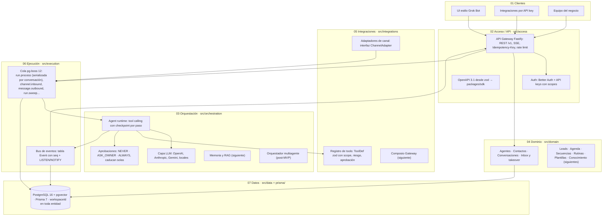
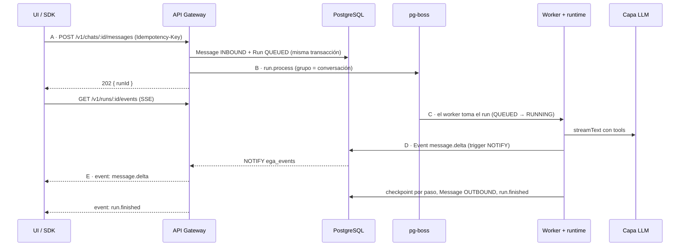
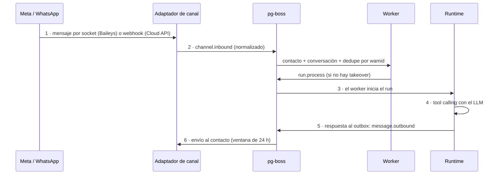
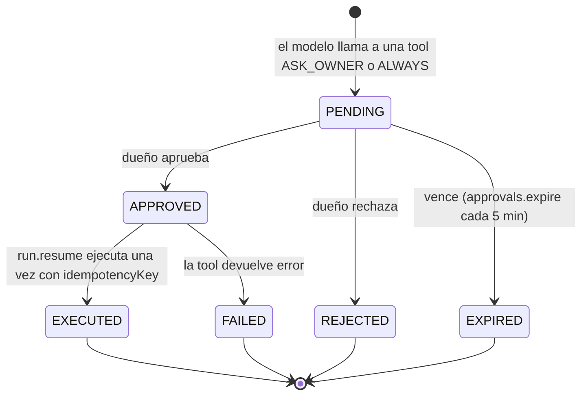

# Arquitectura — Plataforma multiagente (MVP · paridad Auryx)

Versión 1.0 · 21/11/2026 · implementa el diagrama ([arquitectura-v3.png](arquitectura-v3.png)) «Plataforma Multiagente: arquitectura de referencia (MVP)», docs-v3 v1.1.

Motor headless 24/7, un workspace (listo para multitenant). La UI estilo Grok Bot es un proyecto aparte que solo habla con la API pública.

Estado de implementación marcado sobre el diagrama: [arquitectura-v3-estado.png](arquitectura-v3-estado.png) (se regenera con `python3 docs/annotate-estado.py`).

## Capas y carpetas

| Capa del diagrama          | Carpeta                                           | Estado                                                                                                                                                                                                                                                        |
| -------------------------- | ------------------------------------------------- | ------------------------------------------------------------------------------------------------------------------------------------------------------------------------------------------------------------------------------------------------------------- |
| 01 Clientes                | proyecto aparte; `packages/sdk`                   | SDK generado                                                                                                                                                                                                                                                  |
| 02 Acceso / API            | `apps/server/src/access`                          | Hecho: REST /v1 (incl. /v1/me, /v1/tools, /v1/events, listado y cancelación de runs), SSE con ticket, WebSocket, auth (alta cerrada + CLI, API keys con scopes), idempotencia global, rate limit por principal, OpenAPI 3.1, conexiones, webhooks de WhatsApp |
| 03 Orquestación            | `apps/server/src/orchestration`                   | Hecho: runtime con caras interna/externa, aprobaciones con estados EXECUTING/UNKNOWN, cancelación, barrido de huérfanos, capa LLM. Pendiente: memoria con pgvector/RAG, orquestador                                                                           |
| 04 Dominio                 | `apps/server/src/domain`                          | Hecho: agentes, conexiones (catálogo por tipo), contactos, conversaciones, takeover. Pendiente: leads, agenda, secuencias, rutinas, plantillas, conocimiento                                                                                                  |
| 05 Integraciones           | `apps/server/src/integrations`                    | Hecho: registro de tools (internas + Composio por workspace), WhatsApp Cloud API y Baileys, canal `api`. Pendiente: email, Instagram                                                                                                                          |
| 06 Ejecución               | `apps/server/src/execution`                       | Hecho: cola con todos los nombres del diagrama, run.process serializado por conversación, barrido, outbound con estados SENDING/UNKNOWN, sesiones de canal y caducidad; bus ordenado con reconexión                                                           |
| 07 Datos                   | `apps/server/src/data`, `apps/server/prisma`      | Hecho: esquema base y migraciones                                                                                                                                                                                                                             |
| 08 Infraestructura         | `docker/`                                         | Hecho: imagen única, compose (server ROLE=all, postgres+pgvector, caddy, ollama opcional)                                                                                                                                                                     |
| Auditoría y observabilidad | `apps/server/src/shared/observability`            | Hecho: logs pino con redacción, AuditLog, /health, /ready, uso de tokens por run. Pendiente: métricas y costes                                                                                                                                                |
| Seguridad                  | `apps/server/src/shared/security` + `access/auth` | Hecho: AES-256-GCM con AAD y CLI de rotación, sesión de Baileys cifrada, guarda multi-tenant, política de baseURL, claves hasheadas, scopes, firma de webhooks de Meta. Pendiente: firma de webhooks de Composio                                              |

## Flujo «Chat desde la UI» (A → E)

## Flujo «WhatsApp entrante» (1 → 6)

## Aprobaciones

Mecánica: las tools que requieren aprobación se entregan al modelo sin `execute`. El AI SDK ejecuta las automáticas del mismo paso y se detiene dejando la llamada pendiente. El runtime guarda la `Approval` y el checkpoint y pone el run en `WAITING_APPROVAL`. Al decidirse la última pendiente se encola `run.resume`: se ejecuta lo aprobado (o se informa del rechazo o la caducidad), se añade el `tool-result` al historial y el bucle continúa. Un mismo run puede pausar varias veces.

## Modelo de datos (resumen)

`Workspace` · `Membership` (OWNER, ADMIN, OPERATOR) · `ApiKey` (hash + scopes) · `Connection` (secretos cifrados: LLM, Composio, canales) · `Agent` (instrucciones, modelo `conexión:modelo`, tools y overrides, versión) · `Contact` · `Conversation` (canal, takeover, `lastInboundAt`) · `Message` (dedupe por `channelMessageId`, estado de outbox) · `Run` (estado, checkpoint, uso) · `RunStep` · `Approval` · `Memory` · `Routine` · `Event` (seq global) · `IdempotencyRecord` · `AuditLog` · tablas de Better Auth. Detalle en `apps/server/prisma/schema.prisma`.

## Calidad

`pnpm check` = typecheck + ESLint + reglas de capas (dependency-cruiser) + Prettier + tests contra Postgres. Se ejecuta en CI junto con la comprobación de que el OpenAPI y el SDK están al día. Ver `docs/DECISIONS.md` D-012.

## Garantías

| Garantía                         | Cómo                                                                               |
| -------------------------------- | ---------------------------------------------------------------------------------- |
| Aislamiento por workspace        | `workspaceId` sale del `Principal`; todas las consultas lo filtran; tests de cruce |
| Un mensaje, un run               | Dedupe por `channelMessageId` + `@@unique`; Idempotency-Key en la API              |
| Un run lo ejecuta un solo worker | Transición condicionada `QUEUED → RUNNING` / `WAITING_APPROVAL → RUNNING`          |
| Lo aprobado se ejecuta una vez   | Transición atómica de la aprobación + `idempotencyKey` pasada a la tool            |
| Reanudar tras caída              | Checkpoint del historial en cada paso; un reintento de la cola retoma desde ahí    |
| Streaming sin pérdidas           | Eventos persistidos con `seq`; SSE con backlog + `Last-Event-ID`                   |
| Humano al mando                  | Takeover y HANDOFF detienen al agente; las aprobaciones caducan solas              |
