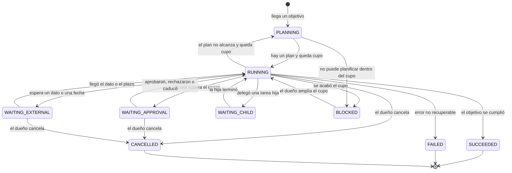
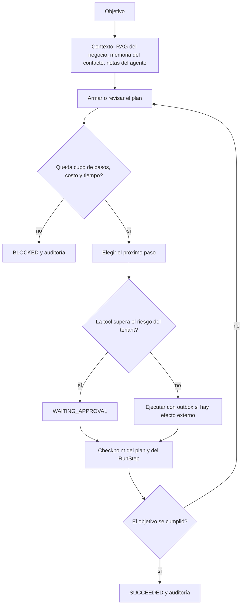
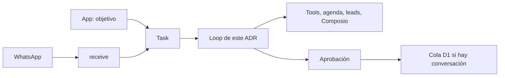

# ADR 003 — Runtime de agentes autónomos

Estado: aceptada (21/11/2026). La confirmó Roberto. Si un texto de `docs/spec-v3/` describe el producto como un conjunto de flujos fijos o como “solo WhatsApp”, manda este ADR.

## Contexto

everglow-agentes es el producto de Everglow. Studio es de Galatea: no comparten código, auth, base ni claves. No los acoples.

El objetivo es automatizar tareas de un negocio con agentes autónomos. El agente recibe una instrucción o un objetivo, investiga, arma un plan, usa tools y ejecuta. Se parece a un asistente personal. No recorre un flujo predefinido: el orden de los pasos lo decide él, dentro de los límites y los permisos del negocio.

Los usos son estos:

- atención al cliente por WhatsApp, con un agente conversacional;
- seguimiento de leads;
- generación de contenido;
- tareas que el dueño lanza desde la app.

WhatsApp es un canal: el agente que contesta. El resto se dispara desde la app.

Los clientes son europeos (España). La residencia de los modelos y la auditoría están en el ADR 005. El motor de jobs está en el ADR 004.

## Decisión

La unidad de trabajo es una **Task**: un objetivo con plan, estado y checkpoints. Un run es un tramo de ejecución de esa tarea (una tanda del loop hasta que pausa o termina). Una conversación de WhatsApp abre una tarea corta atada al hilo. Una orden de la app abre una tarea que puede no tener conversación.

Las secuencias, las rutinas y las plantillas por rubro siguen existiendo. Son tools o puntos de partida que el agente puede usar. No son el producto.

## Qué se reutiliza

No armes un runtime paralelo. Esto ya está y se queda:

| Pieza                                                     | Para qué le sirve a la tarea                                                                                                                         |
| --------------------------------------------------------- | ---------------------------------------------------------------------------------------------------------------------------------------------------- |
| `ChannelAdapter`, contacto, conversación, inbox, takeover | WhatsApp (y el canal que venga) entra por `ConversationService.receive`. Cara externa, HANDOFF y respuesta humana no se reescriben.                  |
| `Approval`, `WAITING_APPROVAL` y la cola del ADR 001      | Una tool que supera el riesgo del tenant pausa el run. Los mensajes que lleguen mientras tanto se encolan y se contestan en un solo run al resolver. |
| Composio con una sola key (ADR 002)                       | Las apps del negocio son tools. El aislamiento sigue siendo `composioUserId(workspaceId)` armado en el servidor.                                     |
| Outbox (`OutboundSend`)                                   | Todo efecto externo (mensaje, turno, acción de app) se toma antes de ejecutarse. Un reintento no lo duplica.                                         |
| Guarda de tenant                                          | Toda consulta de una tarea lleva `workspaceId` del principal o del job. El barrido que cruza workspaces sigue en el cliente de sistema.              |
| `Run`, `RunStep`, barrido, latido                         | El checkpoint del tramo. Si el proceso cae, se retoma el último paso hecho.                                                                          |
| Agenda, leads, rutinas, secuencias                        | Módulos que el agente llama. Inscribir una secuencia es una tool, no el camino obligatorio del seguimiento.                                          |
| Bus de eventos                                            | La app ve plan, tools y cierre sin acoplarse al worker.                                                                                              |

## Qué es nuevo

- La Task como agregado: objetivo, origen, plan versionado, cupo y gasto.
- El loop de razonamiento que revisa el plan, no un guion.
- Cupo de pasos, costo y tiempo, con corte visible.
- Política de riesgo por tenant (uso directo o aprobación), encima de `NEVER` / `ASK_OWNER` / `ALWAYS`.
- Memoria en tres capas: RAG del negocio, memoria del contacto y notas del agente.
- Tareas durables: sobreviven un reinicio y pueden esperar horas o días sin perder el plan (sobre pg-boss, hasta que el ADR 004 diga otra cosa).
- Auditoría de la tarea: decisión, dato, tool, modelo y región.
- Delegación solo cuando la tarea la pide: una Task hija, no un flujo de equipo obligatorio.

## Modelo

```text
Task
  workspaceId, agentId
  goal                          instrucción del dueño o del canal
  source                        app | channel | routine | delegation
  conversationId?, contactId?   vacíos si la tarea no habla con nadie
  parentTaskId?
  status                        ver diagrama
  plan                          pasos con estado; el agente puede reescribirlos
  limits                        maxSteps, maxCostUsd, maxDuration
  spent                         steps, costUsd, startedAt
  runs                          uno o más Run, un tramo entre esperas
```

Una tarea de canal reutiliza el run de la conversación y el mismo advisory lock: un hilo, un tramo a la vez. Una tarea de la app no entra en esa cola de mensajes. Si después escribe por WhatsApp, el envío pasa por el outbox y, si hay una conversación, respeta takeover y ventana.



`WAITING_APPROVAL` es el mismo estado de run que ya existe. No inventes otro. Al salir (aprobado, rechazado o caducado) el tramo sigue y, si la tarea está atada a una conversación, `releaseQueued` suelta los mensajes en un solo run. Eso es el ADR 001: no lo aflojes.

`BLOCKED` no es un fallo del modelo. Es el cupo. El dueño ve el motivo (pasos, costo o tiempo) y puede ampliarlo. Sin eso, la tarea no sigue llamando al modelo.

## Loop



Límites, todos cortan antes de la próxima llamada al modelo:

- **Pasos.** Cada llamada al modelo o tool cuenta. El default lo pone el agente; el tenant puede bajarlo, no saltearse el techo de la plataforma.
- **Costo.** Se suma `Run.costUsd` de los tramos. La tarifa de referencia no es la factura del proveedor: el corte usa ese acumulado y el presupuesto del tenant.
- **Tiempo.** Desde `startedAt`, tiempo de pared, no tiempo de CPU. Una espera (`WAITING_APPROVAL`, `WAITING_EXTERNAL`, `WAITING_CHILD`) no consume el cupo de pasos, pero sí puede vencer el tiempo si el objetivo lo pide. La política del objetivo dice si la espera pausa el reloj. Por defecto la aprobación y la espera externa lo pausan: si no, una decisión del dueño haría fallar la tarea.

El texto del contacto sigue yendo como dato no confiable. El objetivo que escribe el dueño es una instrucción. No mezcles las dos cosas en el mismo sobre.

## Dos puertas, el mismo loop



Un mensaje de WhatsApp no abre un flujo de “recepcionista”. Abre una tarea de canal con cupo corto, cara externa y las tools que el dueño expuso. Dos mensajes seguidos siguen siendo un solo run mientras hay otro activo.

Una orden de la app (“armá el seguimiento de los leads fríos de esta semana y dejame el borrador”) abre una tarea `source=app`. El agente investiga, planifica y ejecuta. Publicar o enviar es un efecto: pasa por riesgo y por outbox.

## Riesgo por tenant

Cada tool ya declara `risk` (`read`, `write`, `send`, `money`, `delete`) y una aprobación de código (`NEVER`, `ASK_OWNER`, `ALWAYS`). Encima, el workspace tiene una política:

| Riesgo   | Default del tenant                                  | Piso que no se negocia                              |
| -------- | --------------------------------------------------- | --------------------------------------------------- |
| `read`   | directo                                             | La cara externa solo lee del contacto actual.       |
| `write`  | directo en cara interna; aprobación en cara externa | El piso de la cara externa no se afloja.            |
| `send`   | aprobación                                          | Hace falta un OWNER para bajarlo, y queda auditado. |
| `money`  | aprobación                                          | Igual que `send`.                                   |
| `delete` | aprobación, y `ALWAYS` si la tool ya lo pide        | Nadie lo pasa a directo con un override del agente. |

La política del tenant solo puede endurecer. `ALWAYS` en la tool sigue ganando. La pausa es `WAITING_APPROVAL`: mismo registro, misma caducidad, misma cola D1 si hay conversación. Una tarea sin conversación espera igual, pero no tiene mensajes que encolar.

## Memoria

Tres capas, las tres con `workspaceId`. No son un solo balde.

| Capa                 | Qué guarda                                                          | Quién la ve                                                                                       |
| -------------------- | ------------------------------------------------------------------- | ------------------------------------------------------------------------------------------------- |
| RAG del negocio      | Precios, FAQ, documentos. Chunks en pgvector.                       | Las dos caras, en modo lectura. El embedding tiene que cumplir el ADR 005.                        |
| Memoria del contacto | Hechos de esa persona.                                              | Cara externa: solo el `contactId` de la conversación. Cara interna: según el permiso del usuario. |
| Notas del agente     | Apuntes de trabajo del agente (decisiones, borradores, pendientes). | Cara interna. No las mezcles con la ficha del contacto.                                           |

`memory.remember` escribe en la capa que el contrato de la tool diga. Borrar un contacto borra su memoria. Las notas del agente que citen a esa persona se tratan como dato personal: entran en la exportación y en el borrado del ADR 005.

Hoy el RAG no está construido. La tarea igual tiene que poder correr con las capas vacías.

## Tareas durables

Después de cada versión del plan y de cada tool, persistís el cursor del plan, el gasto y el `RunStep`. Si el worker muere, el barrido reencola el tramo como ya hace con un run. Si la tarea espera una fecha, el puerto de jobs del ADR 004 programa el despertar (`startAfter` mientras el adaptador sea pg-boss). El plan no vive solo en la memoria del proceso.

Una tarea de días no justifica, por sí sola, cambiar de motor. Justifica checkpoint y un estado `WAITING_EXTERNAL`. El cambio a Temporal tiene criterios propios.

## Auditoría

Al cerrar cada tramo (y al bloquear o cancelar) queda un registro que un cliente europeo pueda mostrar:

- objetivo y quién lo lanzó (usuario, canal o rutina);
- decisión del agente en una frase (qué iba a hacer), no la cadena de pensamiento cruda;
- categorías de datos tocadas (contacto, mensaje, lead, documento);
- tools: nombre, riesgo, si hubo aprobación y cómo terminó;
- modelo, proveedor y región (ADR 005);
- resultado (`SUCCEEDED`, `FAILED`, `BLOCKED`, `CANCELLED`) y costo.

No guardes secretos ni el payload entero de una tool de app en ese registro. El resultado completo, si hace falta para reanudar, sigue en `RunStep` con la retención del ADR 005.

## Varios agentes

Aplica cuando el objetivo no lo puede cerrar un solo agente. `delegate_task` crea una Task hija y la padre pasa a `WAITING_CHILD`. Profundidad máxima: 3. La hija tiene su propio cupo, que descuenta del costo de la padre.

`handoff` de una conversación de WhatsApp es otra cosa: se transfiere el hilo y el agente anterior deja de contestar. No es una tarea hija.

No armes un coordinador obligatorio para el primer corte. La delegación entra cuando una tarea de la app la necesite.

## Consecuencias

- La API gana un recurso de tareas. El chat y el canal siguen siendo puertas, no el modelo.
- Las specs de secuencias, rutinas y plantillas no se tiran: se leen como tools y como semilla de un agente, no como el flujo del negocio.
- El primer corte de código de este ADR es el que lista `docs/ROADMAP.md`. Este documento no implementa nada.
