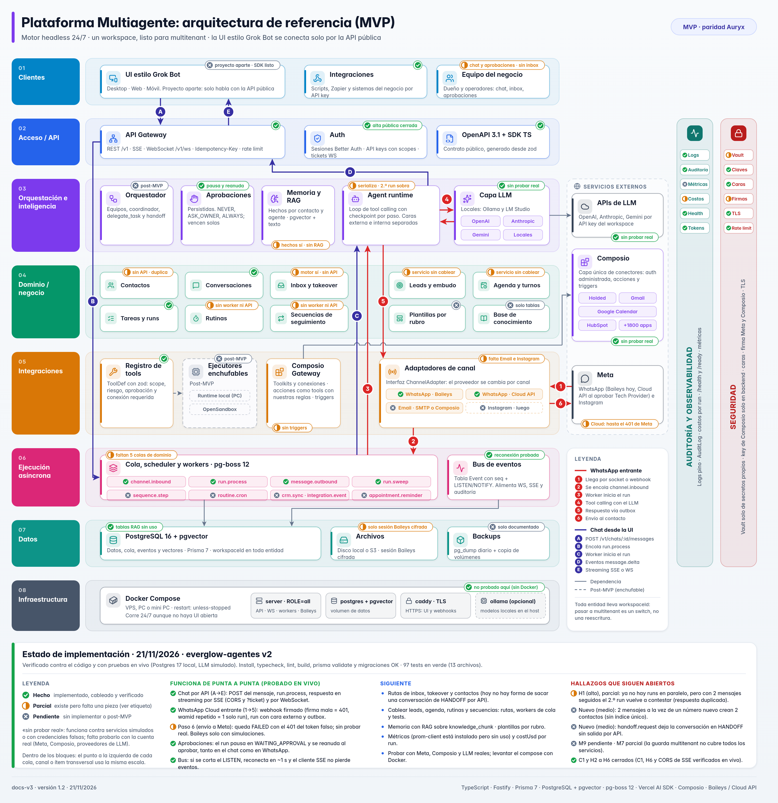
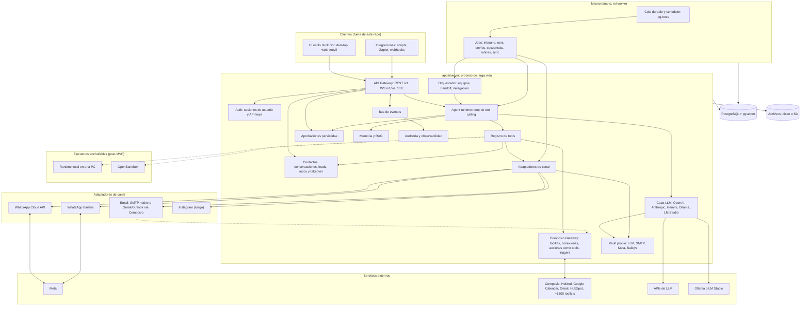
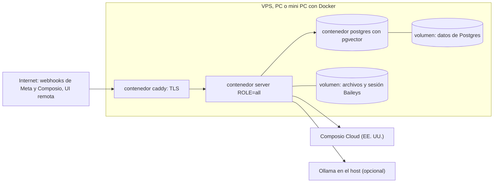

# 01. Arquitectura

## Arquitectura de referencia (MVP)



Versión vectorial: [arquitectura.svg](diagramas/arquitectura.svg) · para imprimir: [arquitectura.pdf](diagramas/arquitectura.pdf). El fuente del generador está en `diagramas/gen.py`.

El diagrama tiene 8 capas, de arriba hacia abajo: clientes, acceso/API, orquestación e inteligencia, dominio, integraciones, ejecución asíncrona, datos e infraestructura. A la derecha están los servicios externos (APIs de LLM, **Composio** como única puerta a apps de terceros y Meta) y dos bandas transversales: auditoría/observabilidad y seguridad. Los flujos numerados son estos:

- **1 a 6 (rojo): WhatsApp entrante.** El mensaje entra por el adaptador, se encola en `channel.inbound`, un worker arranca el run, el agente llama al LLM con tools y la respuesta sale por el outbox y el adaptador.
- **A a E (índigo): chat desde la UI.** La UI hace `POST /v1/chats/:id/messages`, eso encola `run.execute`, un worker ejecuta el run y los eventos `message.delta` vuelven al cliente por SSE o WS.

Lo que está punteado (ejecutores enchufables, Instagram, Ollama) queda para después del MVP o es opcional. Las apps de terceros (Holded, Google, CRMs) entran todas por el **Composio Gateway**; no hay servicios por app (ADR-014).

## Componentes (detalle)



| Componente | Responsabilidad | Paquete |
|---|---|---|
| API Gateway | REST versionado, WS de eventos, SSE de streaming, validación con zod, OpenAPI | `apps/server/src/api` |
| Auth | Sesiones de usuario (Better Auth) y API keys con scopes; resuelve `workspaceId` | `apps/server/src/auth` |
| Agent runtime | Arma el contexto, llama al LLM, ejecuta tools, checkpoint por paso | `packages/core/runtime` |
| Capa LLM | Interfaz única multi-proveedor con API key; modelos locales | `packages/llm` |
| Orquestador | Equipos, coordinador, `handoff_to_agent`, `delegate_task` | `packages/core/orchestrator` |
| Registro de tools | Definición tipada, scope (interno/externo), riesgo, política de aprobación | `packages/tools` |
| Aprobaciones | Persistidas; pausan el run y lo reanudan al decidir | `packages/core/approvals` |
| Memoria y RAG | Hechos por contacto y por agente; base de conocimiento con pgvector | `packages/core/memory` |
| Inbox | Contactos, identidades, conversaciones, mensajes, leads, takeover | `packages/core/inbox` |
| Composio Gateway | Única puerta a apps de terceros: catálogo de toolkits, Connect Link y callback, connected accounts por `user_id`, acciones expuestas como tools con nuestras reglas, triggers entrantes, Proxy Execute | `packages/tools/composio` |
| Vault | Secretos propios que no son de Composio: claves de LLM, SMTP, token de Meta Cloud API, sesión de Baileys | `packages/vault` |
| Canales | Interfaz `ChannelAdapter`; Baileys, Cloud API, email (SMTP o Composio), IG | `packages/channels` |
| Cola y scheduler | pg-boss: jobs, reintentos, cron, `startAfter` | `apps/server/src/jobs` |
| Bus de eventos | Tabla `Event` con `seq` + LISTEN/NOTIFY; alimenta WS y auditoría | `packages/core/events` |
| Auditoría | `AuditLog`, logs pino, métricas, costos por run | `packages/core/audit` |
| Ejecutores (futuro) | `DeviceExecutor`: runtime local por WS saliente, OpenSandbox | `packages/executors` |

## Conectores: Composio como capa única

Ninguna app de terceros tiene código propio en el repo. Todas pasan por `ComposioGateway`, que vive dentro del registro de tools (ADR-014).

```text
Agente ──► Registro de tools ──► reglas propias (cara, riesgo, aprobación, outbox, auditoría)
                                   │
                                   ├─ tools nativas (kb, leads, inbox, mensajes…)
                                   └─ ComposioGateway ──► Composio ──► Holded, Google Calendar, Gmail, HubSpot…
```

| Pieza | Qué hace |
|---|---|
| Catálogo | `GET /v1/connections/toolkits` consulta los toolkits de Composio (cacheados 1 h) y marca cuáles están conectados |
| Conexión | Arma el `user_id` (`ws_<workspaceId>:integration` o `ws_<workspaceId>:user_<userId>`), pide un Connect Link (`connectedAccounts.link`) con `callbackUrl` propio y guarda una `Connection` en `INITIATED`. En el callback confirma el estado leyendo el connected account desde Composio (no se confía en la query) |
| Acciones como tools | El dueño habilita acciones por toolkit (`AppTool`). Cada una se publica como `app.<toolkit>.<acción>` con el schema de Composio, la versión fijada del toolkit y nuestra política. Default según riesgo: lectura `NEVER`, escritura `ASK_OWNER`, borrado `ALWAYS`; nunca `external` salvo que el dueño lo marque |
| Ejecución | `session.execute(slug, args)` con una sesión de Composio en preset de tools directas para el `user_id` y la cuenta elegida. Las escrituras pasan por el outbox |
| Triggers | Composio firma y entrega eventos (p. ej. `GMAIL_NEW_GMAIL_MESSAGE`, `GOOGLECALENDAR_EVENT_CREATED`) en `POST /v1/webhooks/composio`. Se verifican con `triggers.verifyWebhook`, se mapean a la `Connection` y se encolan como `integration.event` (rutinas, canal de email, sync) |
| Fuera de catálogo | Proxy Execute con la misma conexión, después Custom MCP, después tool local. Ver ADR-014 |

**Por qué los canales siguen nativos.** WhatsApp (Baileys o Cloud API) es mensajería entrante en tiempo real:

- Cloud API exige un webhook propio verificado con `X-Hub-Signature-256` y respuesta 200 rápida (Meta reintenta hasta 7 días); Baileys es un socket persistente.
- El código aplica la ventana de 24 h y las plantillas.
- Hay takeover humano, orden estricto por conversación e idempotencia por `wamid`.

Nada de eso es una acción puntual sobre una app; es transporte. Composio tiene un toolkit `WHATSAPP` (Cloud API, 127 acciones), pero su único trigger es `WHATSAPP_MESSAGE_STATUS_UPDATED_TRIGGER`: no entrega mensajes entrantes y no cubre Baileys. Además, un intermediario en la ruta crítica sumaría latencia y otro punto de falla. Ese toolkit puede servir después para tareas administrativas de la WABA, como plantillas, como cualquier otra app.

**Email**: el envío puede ir por SMTP nativo o por la acción `GMAIL_SEND_EMAIL` de Composio. La entrada **sí** puede cubrirse con el trigger `GMAIL_NEW_GMAIL_MESSAGE` (en tiempo real con la auth administrada por Composio), que se normaliza como mensaje entrante del canal `COMPOSIO_EMAIL`. Así el email entrante sale del "futuro" sin pasar por la verificación del scope restringido de Gmail, porque esa verificación la tiene la app OAuth administrada por Composio.

## Procesos y despliegue

Un solo binario (`apps/server`) con dos roles por variable `ROLE`:

- `ROLE=all` (default MVP): API, WS, worker y socket de Baileys en un proceso.
- `ROLE=api` y `ROLE=worker` separados cuando haga falta escalar. **El socket de Baileys vive siempre en un único worker** (lock con advisory lock de Postgres por canal).



- `docker compose up -d` levanta todo. Caddy da HTTPS automático (necesario para webhooks de Meta Cloud API y para la UI remota).
- En una PC o mini PC sin IP pública: túnel (Cloudflare Tunnel o similar) ⚠ VERIFICAR opción elegida.
- Backups: `pg_dump` diario más copia del volumen de archivos (spec 23).

## Flujo general

1. Un evento entra: mensaje de canal, mensaje del dueño por API, disparador de rutina, paso de secuencia, webhook.
2. Se persiste y se encola un job (idempotente por ID externo).
3. El worker resuelve **qué agente** atiende (ruteo del canal o del chat) y crea un `Run`.
4. El runtime ejecuta el loop: LLM → tools → checkpoint, pidiendo aprobación si la política lo exige.
5. Los efectos externos pasan por el **outbox** (`OutboundSend`) con clave de idempotencia.
6. Cada cambio emite un `Event`; la UI lo recibe por WS y el streaming de tokens por SSE o WS.
