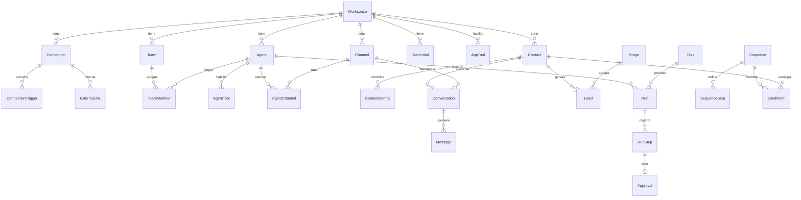

# 03. Modelo de datos

PostgreSQL 16+ con pgvector, Prisma **7.10.x** (estable al 21/11/2026; el tag `latest` de npm apunta a 8.0.0-rc, no usarlo). Validado con `prisma validate` 7.10.1.

## Reglas

- **Toda entidad de negocio tiene `workspaceId`** (las hijas directas, como `RunStep` o `SequenceStep`, lo heredan del padre). Ninguna query de repositorio se escribe sin `workspaceId` (extensión de Prisma que lo exige, spec T10.4).
- IDs UUID; fechas en UTC; el huso del negocio vive en `Workspace.timezone`.
- Credenciales de apps de terceros (Holded, Google, CRMs…): **no se guardan acá**. Las custodia Composio; nosotros guardamos solo el `composioConnectedAccountId` y el estado (`Connection`). Ver ADR-014.
- Credenciales propias (claves de LLM, SMTP, token de Meta Cloud API, sesión de Baileys): solo en `Secret` (AES-256-GCM con clave maestra por variable de entorno o archivo montado), referenciadas desde `Credential` o `Channel`.
- Efectos externos: `OutboundSend` (outbox) con `@@unique([workspaceId, idempotencyKey])`.
- Eventos: `Event.seq` monotónico; la UI reanuda el WS desde el último `seq` visto.
- Embeddings `vector(1536)` (⚠ VERIFICAR la dimensión del modelo de embeddings elegido; cambiarla exige migración). Índice HNSW en migración SQL manual.
- Prisma 7: `datasource.url` va en `prisma.config.ts`; el cliente usa un driver adapter (`@prisma/adapter-pg`) ⚠ VERIFICAR detalles al crear el repo.

## Relaciones principales



## Esquema Prisma

```prisma
generator client {
  provider = "prisma-client-js"
}

// Prisma 7: la URL va en prisma.config.ts. La extensión pgvector se crea en la primera migración:
// CREATE EXTENSION IF NOT EXISTS vector;
datasource db {
  provider = "postgresql"
}

// ---------- Workspace, usuarios y acceso ----------

model Workspace {
  id        String   @id @default(uuid())
  name      String
  timezone  String   @default("America/Argentina/Buenos_Aires")
  locale    String   @default("es-AR")
  settings  Json     @default("{}")
  createdAt DateTime @default(now())

  members       Member[]
  apiKeys       ApiKey[]
  agents        Agent[]
  teams         Team[]
  connections   Connection[]
  credentials   Credential[]
  appTools      AppTool[]
  channels      Channel[]
  contacts      Contact[]
  conversations Conversation[]
  leads         Lead[]
  runs          Run[]
  tasks         Task[]
  routines      Routine[]
  sequences     Sequence[]
  approvals     Approval[]
  events        Event[]
}

model User {
  id            String   @id @default(uuid())
  email         String   @unique
  name          String?
  emailVerified Boolean  @default(false)
  image         String?
  createdAt     DateTime @default(now())
  updatedAt     DateTime @updatedAt
  members       Member[]
  // Tablas de sesión y cuenta las genera Better Auth (⚠ VERIFICAR nombres al correr su CLI)
}

enum MemberRole {
  OWNER
  ADMIN
  OPERATOR
}

model Member {
  id          String     @id @default(uuid())
  workspaceId String
  userId      String
  role        MemberRole @default(OWNER)
  createdAt   DateTime   @default(now())
  workspace   Workspace  @relation(fields: [workspaceId], references: [id], onDelete: Cascade)
  user        User       @relation(fields: [userId], references: [id], onDelete: Cascade)

  @@unique([workspaceId, userId])
}

model ApiKey {
  id          String    @id @default(uuid())
  workspaceId String
  name        String
  prefix      String    @unique // primeros caracteres visibles, ej. "pk_7Hc2"
  hash        String    @unique // SHA-256 de la key completa
  scopes      String[]
  createdById String?
  lastUsedAt  DateTime?
  expiresAt   DateTime?
  revokedAt   DateTime?
  createdAt   DateTime  @default(now())
  workspace   Workspace @relation(fields: [workspaceId], references: [id], onDelete: Cascade)

  @@index([workspaceId])
}

// ---------- Agentes y equipos ----------

enum AgentFace {
  EXTERNAL
  INTERNAL
  BOTH
}

enum ApprovalPolicy {
  NEVER
  ASK_OWNER
  ALWAYS
}

model Agent {
  id            String    @id @default(uuid())
  workspaceId   String
  name          String
  role          String
  avatar        String?
  face          AgentFace @default(INTERNAL)
  systemPrompt  String
  modelProvider String // openai | anthropic | google | ollama | lmstudio
  model         String
  temperature   Float?
  limits        Json      @default("{\"maxStepsPerRun\":12,\"maxConcurrentRuns\":3}")
  schedule      Json? // horario de atención
  templateId    String?
  archivedAt    DateTime?
  createdAt     DateTime  @default(now())
  updatedAt     DateTime  @updatedAt

  workspace     Workspace        @relation(fields: [workspaceId], references: [id], onDelete: Cascade)
  tools         AgentTool[]
  channels      AgentChannel[]
  knowledge     AgentKnowledge[]
  teamMembers   TeamMember[]
  runs          Run[]
  conversations Conversation[]

  @@index([workspaceId])
}

model AgentTool {
  id       String          @id @default(uuid())
  agentId  String
  toolKey  String
  approval ApprovalPolicy?
  config   Json            @default("{}")
  enabled  Boolean         @default(true)
  agent    Agent           @relation(fields: [agentId], references: [id], onDelete: Cascade)

  @@unique([agentId, toolKey])
}

model AgentChannel {
  agentId   String
  channelId String
  priority  Int     @default(0)
  agent     Agent   @relation(fields: [agentId], references: [id], onDelete: Cascade)
  channel   Channel @relation(fields: [channelId], references: [id], onDelete: Cascade)

  @@id([agentId, channelId])
}

model Team {
  id            String       @id @default(uuid())
  workspaceId   String
  name          String
  description   String?
  coordinatorId String?
  createdAt     DateTime     @default(now())
  workspace     Workspace    @relation(fields: [workspaceId], references: [id], onDelete: Cascade)
  members       TeamMember[]

  @@index([workspaceId])
}

model TeamMember {
  teamId        String
  agentId       String
  canDelegateTo String[] // agentIds; vacío = todos los del equipo
  team          Team     @relation(fields: [teamId], references: [id], onDelete: Cascade)
  agent         Agent    @relation(fields: [agentId], references: [id], onDelete: Cascade)

  @@id([teamId, agentId])
}

// ---------- Conexiones (Composio), credenciales propias y canales ----------

// Connection = connected account de Composio. Los tokens o API keys quedan en Composio,
// nunca en esta base. composioUserId sigue el modelo B2B de Composio:
//   "ws_<workspaceId>:integration"     cuenta del negocio (default)
//   "ws_<workspaceId>:user_<userId>"   cuenta personal de un miembro
enum ConnectionOwner {
  WORKSPACE
  MEMBER
}

enum ConnectionStatus {
  INITIATED // Connect Link emitido, falta que el usuario termine
  ACTIVE
  NEEDS_REAUTH // Composio reporta EXPIRED o la app devolvió 401
  FAILED
  DISABLED
}

model Connection {
  id                         String              @id @default(uuid())
  workspaceId                String
  toolkit                    String // slug de Composio: holded, googlecalendar, gmail, hubspot…
  owner                      ConnectionOwner     @default(WORKSPACE)
  memberUserId               String? // solo si owner = MEMBER
  composioUserId             String
  composioAuthConfigId       String? // null = auth administrada por Composio
  composioConnectedAccountId String?             @unique // null mientras está INITIATED
  linkNonce                  String?             @unique // correlaciona el callback del Connect Link
  label                      String
  accountRef                 String? // email o nombre de la cuenta, solo para mostrar
  status                     ConnectionStatus    @default(INITIATED)
  statusReason               String?
  meta                       Json                @default("{}")
  createdAt                  DateTime            @default(now())
  updatedAt                  DateTime            @updatedAt
  workspace                  Workspace           @relation(fields: [workspaceId], references: [id], onDelete: Cascade)
  triggers                   ConnectionTrigger[]
  links                      ExternalLink[]

  @@index([workspaceId, toolkit])
  @@index([composioUserId])
}

// Trigger de Composio activado sobre una conexión (p. ej. GMAIL_NEW_GMAIL_MESSAGE).
model ConnectionTrigger {
  id                String     @id @default(uuid())
  workspaceId       String
  connectionId      String
  triggerSlug       String
  composioTriggerId String     @unique // ti_*
  target            String // ROUTINE:<routineId> | CHANNEL:<channelId> | SYNC
  config            Json       @default("{}")
  enabled           Boolean    @default(true)
  createdAt         DateTime   @default(now())
  connection        Connection @relation(fields: [connectionId], references: [id], onDelete: Cascade)

  @@index([workspaceId])
}

// Acción de Composio habilitada en el workspace y expuesta como tool propia.
// Encima van nuestras reglas: scope (cara), riesgo y aprobación.
model AppTool {
  id              String         @id @default(uuid())
  workspaceId     String
  toolKey         String // "app.holded.create_contact"
  toolkit         String // "holded"
  actionSlug      String // "HOLDED_CREATE_CONTACT"
  toolkitVersion  String // versión fijada, p. ej. "20261101_00"
  scope           String         @default("internal") // internal | external
  risk            String // read | write | send | money | delete
  defaultApproval ApprovalPolicy
  inputSchema     Json // snapshot del schema al habilitarla
  enabled         Boolean        @default(true)
  createdAt       DateTime       @default(now())
  updatedAt       DateTime       @updatedAt
  workspace       Workspace      @relation(fields: [workspaceId], references: [id], onDelete: Cascade)

  @@unique([workspaceId, toolKey])
}

// Vínculo genérico entre una entidad nuestra y su espejo en una app externa (CRM, agenda…).
model ExternalLink {
  id           String     @id @default(uuid())
  workspaceId  String
  connectionId String
  entityType   String // CONTACT | LEAD | STAGE | APPOINTMENT
  entityId     String
  externalId   String
  syncedAt     DateTime?
  connection   Connection @relation(fields: [connectionId], references: [id], onDelete: Cascade)

  @@unique([connectionId, entityType, entityId])
  @@unique([connectionId, entityType, externalId])
  @@index([workspaceId, entityType, entityId])
}

// Secretos propios que no pasan por Composio.
enum CredentialKind {
  LLM_OPENAI
  LLM_ANTHROPIC
  LLM_GOOGLE
  LLM_LOCAL
  SMTP
}

model Credential {
  id          String         @id @default(uuid())
  workspaceId String
  kind        CredentialKind
  label       String
  status      String         @default("ACTIVE") // ACTIVE | ERROR | DISABLED
  secretId    String         @unique
  createdAt   DateTime       @default(now())
  updatedAt   DateTime       @updatedAt
  workspace   Workspace      @relation(fields: [workspaceId], references: [id], onDelete: Cascade)
  secret      Secret         @relation(fields: [secretId], references: [id])

  @@index([workspaceId, kind])
}

model Secret {
  id          String      @id @default(uuid())
  workspaceId String
  ciphertext  Bytes // AES-256-GCM, clave maestra fuera de la DB
  iv          Bytes
  keyVersion  Int         @default(1)
  createdAt   DateTime    @default(now())
  rotatedAt   DateTime?
  credential  Credential?
  channel     Channel?

  @@index([workspaceId])
}

enum ChannelKind {
  WHATSAPP
  EMAIL
  INSTAGRAM
  MESSENGER
  WEBCHAT
}

enum ChannelProvider {
  BAILEYS
  META_CLOUD
  SMTP
  COMPOSIO_EMAIL // Gmail u Outlook vía Composio: envío por acción, entrada por trigger
  META_IG
  META_MESSENGER
  WEBCHAT
}

enum ChannelStatus {
  PENDING
  CONNECTED
  DISCONNECTED
  ERROR
}

model Channel {
  id             String          @id @default(uuid())
  workspaceId    String
  kind           ChannelKind
  provider       ChannelProvider
  name           String
  address        String // E.164 del número, email, ID de cuenta IG
  status         ChannelStatus   @default(PENDING)
  config         Json            @default("{}") // phoneNumberId, wabaId, horario, mensaje fuera de horario
  secretId       String?         @unique // token Cloud API o estado de sesión Baileys cifrado
  defaultAgentId String?
  createdAt      DateTime        @default(now())
  updatedAt      DateTime        @updatedAt
  workspace      Workspace       @relation(fields: [workspaceId], references: [id], onDelete: Cascade)
  secret         Secret?         @relation(fields: [secretId], references: [id])
  agents         AgentChannel[]
  conversations  Conversation[]

  @@unique([workspaceId, kind, address])
}

// ---------- Contactos, conversaciones, mensajes ----------

model Contact {
  id            String            @id @default(uuid())
  workspaceId   String
  name          String?
  tags          String[]
  attributes    Json              @default("{}")
  optOut        Boolean           @default(false)
  createdAt     DateTime          @default(now())
  updatedAt     DateTime          @updatedAt
  workspace     Workspace         @relation(fields: [workspaceId], references: [id], onDelete: Cascade)
  identities    ContactIdentity[]
  conversations Conversation[]
  leads         Lead[]
  enrollments   Enrollment[]
  memories      Memory[]

  @@index([workspaceId])
}

enum IdentityKind {
  PHONE
  EMAIL
  WHATSAPP_JID
  INSTAGRAM
  MESSENGER
}

model ContactIdentity {
  id          String       @id @default(uuid())
  workspaceId String
  contactId   String
  kind        IdentityKind
  value       String // normalizado: E.164, email en minúsculas
  contact     Contact      @relation(fields: [contactId], references: [id], onDelete: Cascade)

  @@unique([workspaceId, kind, value])
}

enum ConversationKind {
  EXTERNAL
  INTERNAL
}

enum ConversationStatus {
  OPEN
  PENDING_HUMAN
  HUMAN
  CLOSED
}

model Conversation {
  id             String             @id @default(uuid())
  workspaceId    String
  kind           ConversationKind
  channelId      String?
  contactId      String?
  agentId        String?
  userId         String? // INTERNAL: usuario que chatea
  title          String?
  status         ConversationStatus @default(OPEN)
  assignedUserId String? // takeover humano
  lastInboundAt  DateTime? // ventana de 24 h
  lastMessageAt  DateTime?
  createdAt      DateTime           @default(now())
  workspace      Workspace          @relation(fields: [workspaceId], references: [id], onDelete: Cascade)
  channel        Channel?           @relation(fields: [channelId], references: [id])
  contact        Contact?           @relation(fields: [contactId], references: [id])
  agent          Agent?             @relation(fields: [agentId], references: [id])
  messages       Message[]
  runs           Run[]

  @@index([workspaceId, kind, lastMessageAt])
  @@index([workspaceId, contactId])
}

enum MessageRole {
  CONTACT
  AGENT
  HUMAN
  USER
  SYSTEM
  TOOL
}

enum MessageStatus {
  RECEIVED
  QUEUED
  SENT
  DELIVERED
  READ
  FAILED
}

model Message {
  id             String        @id @default(uuid())
  workspaceId    String
  conversationId String
  role           MessageRole
  authorId       String? // agentId o userId
  content        String
  attachments    Json          @default("[]")
  externalId     String? // ID del proveedor (wamid, Message-ID)
  status         MessageStatus @default(RECEIVED)
  runId          String?
  meta           Json          @default("{}")
  createdAt      DateTime      @default(now())
  conversation   Conversation  @relation(fields: [conversationId], references: [id], onDelete: Cascade)

  @@unique([workspaceId, externalId])
  @@index([conversationId, createdAt])
}

// ---------- Leads ----------

model Pipeline {
  id               String  @id @default(uuid())
  workspaceId      String
  name             String
  syncConnectionId String? // CRM espejo opcional (Connection de Composio: holded, hubspot…)
  stages           Stage[]
  leads            Lead[]

  @@index([workspaceId])
}

model Stage {
  id         String   @id @default(uuid())
  pipelineId String
  name       String
  position   Int
  pipeline   Pipeline @relation(fields: [pipelineId], references: [id], onDelete: Cascade)
  leads      Lead[]

  @@unique([pipelineId, position])
}

model Lead {
  id          String    @id @default(uuid())
  workspaceId String
  contactId   String
  pipelineId  String
  stageId     String
  title       String
  value       Decimal?  @db.Decimal(12, 2)
  score       Int?
  source      String? // whatsapp, routine, manual
  notes       String?
  createdAt   DateTime  @default(now())
  updatedAt   DateTime  @updatedAt
  workspace   Workspace @relation(fields: [workspaceId], references: [id], onDelete: Cascade)
  contact     Contact   @relation(fields: [contactId], references: [id])
  pipeline    Pipeline  @relation(fields: [pipelineId], references: [id])
  stage       Stage     @relation(fields: [stageId], references: [id])

  @@index([workspaceId, stageId])
}

model Appointment {
  id              String   @id @default(uuid())
  workspaceId     String
  contactId       String?
  connectionId    String? // Connection de Composio (googlecalendar u otra agenda)
  calendarId      String?
  idempotencyKey  String // va en extended_properties.private del evento; se busca antes de reintentar
  externalEventId String? // ID que devuelve la agenda
  startsAt        DateTime
  endsAt          DateTime
  status          String   @default("CONFIRMED") // CONFIRMED | CANCELLED
  createdByRunId  String?
  createdAt       DateTime @default(now())

  @@unique([workspaceId, idempotencyKey])
  @@index([workspaceId, startsAt])
}

// ---------- Tareas, runs, aprobaciones ----------

enum TaskStatus {
  OPEN
  RUNNING
  WAITING
  DONE
  FAILED
  CANCELLED
}

model Task {
  id              String     @id @default(uuid())
  workspaceId     String
  title           String
  instructions    String
  assigneeAgentId String
  parentTaskId    String?
  createdByType   String // user | agent | routine | sequence
  createdById     String?
  status          TaskStatus @default(OPEN)
  result          String?
  dueAt           DateTime?
  createdAt       DateTime   @default(now())
  updatedAt       DateTime   @updatedAt
  workspace       Workspace  @relation(fields: [workspaceId], references: [id], onDelete: Cascade)
  runs            Run[]

  @@index([workspaceId, status])
}

enum RunStatus {
  QUEUED
  RUNNING
  WAITING_APPROVAL
  WAITING_CHILD
  COMPLETED
  FAILED
  CANCELLED
}

enum RunTrigger {
  INBOUND_MESSAGE
  USER_CHAT
  TASK
  ROUTINE
  SEQUENCE
  DELEGATION
  WEBHOOK
}

model Run {
  id             String        @id @default(uuid())
  workspaceId    String
  agentId        String
  trigger        RunTrigger
  conversationId String?
  taskId         String?
  parentRunId    String?
  status         RunStatus     @default(QUEUED)
  stepCount      Int           @default(0)
  inputTokens    Int           @default(0)
  outputTokens   Int           @default(0)
  costUsd        Decimal       @default(0) @db.Decimal(10, 4)
  error          String?
  startedAt      DateTime?
  finishedAt     DateTime?
  createdAt      DateTime      @default(now())
  workspace      Workspace     @relation(fields: [workspaceId], references: [id], onDelete: Cascade)
  agent          Agent         @relation(fields: [agentId], references: [id])
  conversation   Conversation? @relation(fields: [conversationId], references: [id])
  task           Task?         @relation(fields: [taskId], references: [id])
  steps          RunStep[]

  @@index([workspaceId, status])
  @@index([agentId, status])
}

enum StepKind {
  LLM
  TOOL_CALL
  TOOL_RESULT
  MESSAGE
  DELEGATION
  APPROVAL
}

model RunStep {
  id             String   @id @default(uuid())
  runId          String
  index          Int
  kind           StepKind
  toolKey        String?
  input          Json?
  output         Json?
  status         String   @default("DONE") // PENDING | DONE | FAILED
  idempotencyKey String?  @unique
  durationMs     Int?
  createdAt      DateTime @default(now())
  run            Run      @relation(fields: [runId], references: [id], onDelete: Cascade)

  @@unique([runId, index])
}

enum ApprovalStatus {
  PENDING
  APPROVED
  REJECTED
  EXPIRED
  CANCELLED
}

model Approval {
  id          String         @id @default(uuid())
  workspaceId String
  runId       String
  stepId      String         @unique
  toolKey     String
  summary     String // texto para la UI: "Enviar a Juan: ..."
  payload     Json
  status      ApprovalStatus @default(PENDING)
  decidedById String?
  decidedAt   DateTime?
  expiresAt   DateTime
  createdAt   DateTime       @default(now())
  workspace   Workspace      @relation(fields: [workspaceId], references: [id], onDelete: Cascade)

  @@index([workspaceId, status])
}

// ---------- Outbox de efectos externos ----------

enum SendStatus {
  PENDING
  SENT
  FAILED
  UNKNOWN
}

model OutboundSend {
  id             String     @id @default(uuid())
  workspaceId    String
  idempotencyKey String
  kind           String // message | email | app (acción de Composio)
  target         String
  payload        Json
  status         SendStatus @default(PENDING)
  externalId     String?
  attempts       Int        @default(0)
  lastError      String?
  createdAt      DateTime   @default(now())
  updatedAt      DateTime   @updatedAt

  @@unique([workspaceId, idempotencyKey])
}

// ---------- Rutinas y secuencias ----------

enum RoutineTrigger {
  CRON
  EVENT
  WEBHOOK
}

model Routine {
  id           String         @id @default(uuid())
  workspaceId  String
  name         String
  agentId      String
  trigger      RoutineTrigger
  cron         String?
  eventType    String?
  webhookToken String?        @unique
  instructions String
  enabled      Boolean        @default(true)
  lastRunAt    DateTime?
  createdAt    DateTime       @default(now())
  workspace    Workspace      @relation(fields: [workspaceId], references: [id], onDelete: Cascade)

  @@index([workspaceId])
}

model Sequence {
  id          String         @id @default(uuid())
  workspaceId String
  name        String
  agentId     String? // redacta pasos con IA si el paso lo pide
  stopOnReply Boolean        @default(true)
  enabled     Boolean        @default(true)
  createdAt   DateTime       @default(now())
  workspace   Workspace      @relation(fields: [workspaceId], references: [id], onDelete: Cascade)
  steps       SequenceStep[]
  enrollments Enrollment[]

  @@index([workspaceId])
}

model SequenceStep {
  id              String      @id @default(uuid())
  sequenceId      String
  position        Int
  delayMinutes    Int
  channelKind     ChannelKind
  mode            String // TEMPLATE | AI_DRAFT | FIXED
  templateName    String? // plantilla de WhatsApp aprobada
  body            String?
  requireApproval Boolean     @default(false)
  sequence        Sequence    @relation(fields: [sequenceId], references: [id], onDelete: Cascade)

  @@unique([sequenceId, position])
}

model Enrollment {
  id            String    @id @default(uuid())
  workspaceId   String
  sequenceId    String
  contactId     String
  currentStep   Int       @default(0)
  status        String    @default("ACTIVE") // ACTIVE | COMPLETED | STOPPED
  nextAt        DateTime?
  stoppedReason String?
  createdAt     DateTime  @default(now())
  sequence      Sequence  @relation(fields: [sequenceId], references: [id], onDelete: Cascade)
  contact       Contact   @relation(fields: [contactId], references: [id], onDelete: Cascade)

  @@unique([sequenceId, contactId])
}

// ---------- Memoria, conocimiento, plantillas ----------

enum MemoryScope {
  WORKSPACE
  AGENT
  CONTACT
}

model Memory {
  id          String                       @id @default(uuid())
  workspaceId String
  scope       MemoryScope
  agentId     String?
  contactId   String?
  content     String
  source      String? // runId o "manual"
  embedding   Unsupported("vector(1536)")?
  createdAt   DateTime                     @default(now())
  contact     Contact?                     @relation(fields: [contactId], references: [id], onDelete: Cascade)

  @@index([workspaceId, scope])
}

model KnowledgeSource {
  id          String           @id @default(uuid())
  workspaceId String
  name        String
  kind        String // faq | document | url | text
  status      String           @default("READY")
  createdAt   DateTime         @default(now())
  chunks      KnowledgeChunk[]
  agents      AgentKnowledge[]

  @@index([workspaceId])
}

model KnowledgeChunk {
  id        String                       @id @default(uuid())
  sourceId  String
  content   String
  embedding Unsupported("vector(1536)")?
  meta      Json                         @default("{}")
  source    KnowledgeSource              @relation(fields: [sourceId], references: [id], onDelete: Cascade)

  @@index([sourceId])
}

model AgentKnowledge {
  agentId  String
  sourceId String
  agent    Agent           @relation(fields: [agentId], references: [id], onDelete: Cascade)
  source   KnowledgeSource @relation(fields: [sourceId], references: [id], onDelete: Cascade)

  @@id([agentId, sourceId])
}

model TemplateInstall {
  id          String   @id @default(uuid())
  workspaceId String
  templateKey String // "peluqueria", "inmobiliaria"
  version     String
  answers     Json // respuestas del configurador
  createdIds  Json // agentes, secuencias, fuentes creadas
  createdAt   DateTime @default(now())

  @@index([workspaceId])
}

// ---------- Eventos y auditoría ----------

model Event {
  seq         BigInt    @id @default(autoincrement())
  workspaceId String
  type        String // message.created, run.updated, approval.requested...
  subjectId   String?
  data        Json
  createdAt   DateTime  @default(now())
  workspace   Workspace @relation(fields: [workspaceId], references: [id], onDelete: Cascade)

  @@index([workspaceId, seq])
}

model AuditLog {
  id          String   @id @default(uuid())
  workspaceId String
  actorType   String // user | apikey | agent | system
  actorId     String?
  action      String
  target      String?
  data        Json     @default("{}")
  createdAt   DateTime @default(now())

  @@index([workspaceId, createdAt])
}

model IdempotencyRecord {
  workspaceId String
  key         String
  method      String
  path        String
  requestHash String
  response    Json
  createdAt   DateTime @default(now())

  @@id([workspaceId, key])
}
```
