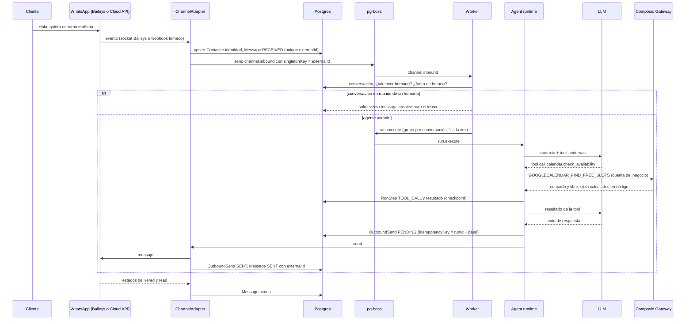
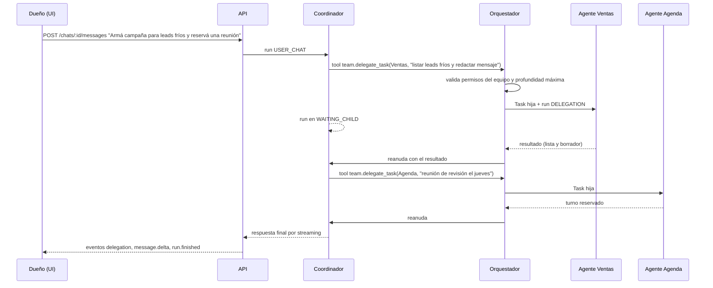
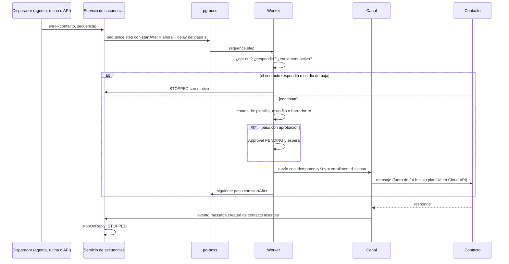
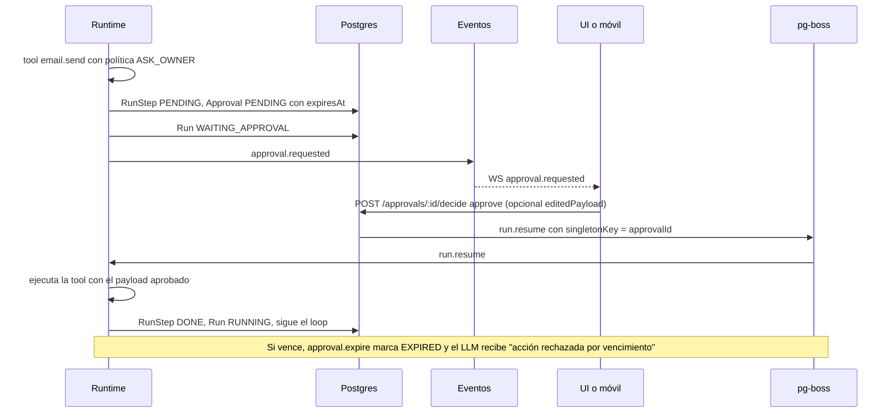
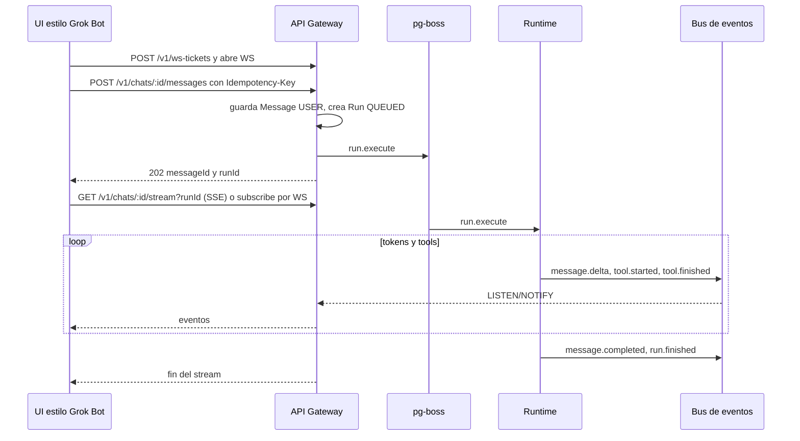
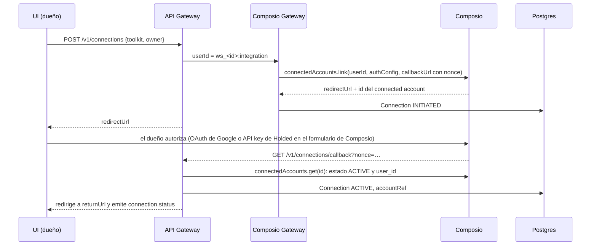
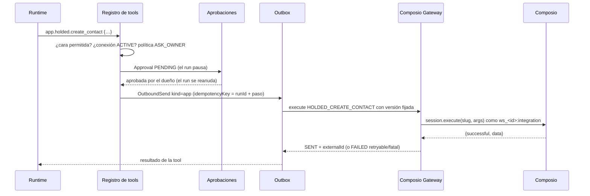
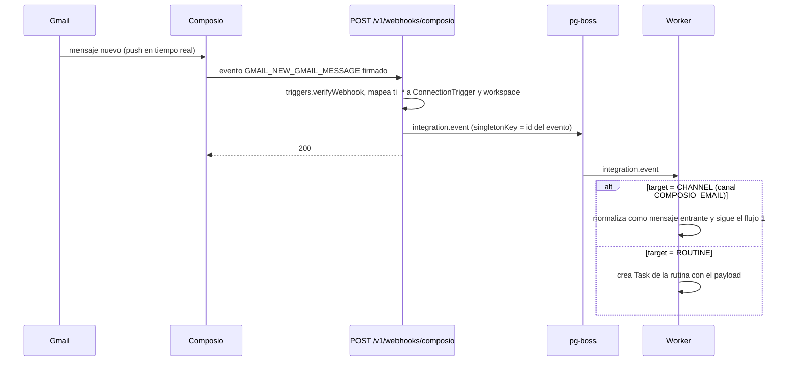
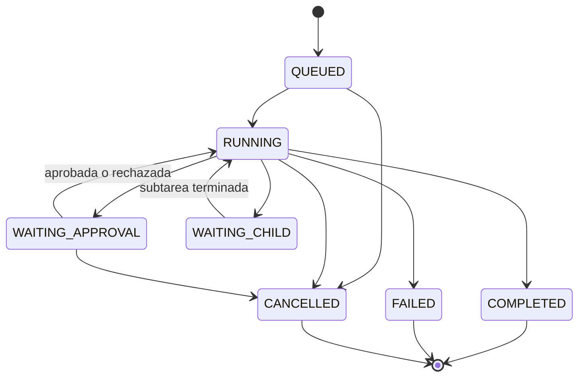

# 05. Flujos clave

## 1. WhatsApp entrante → respuesta del agente

## 2. Delegación entre agentes (equipo)

`team.handoff_to_agent` es distinto: transfiere **la conversación** (por ejemplo, de Recepción a Ventas en WhatsApp) y el agente original deja de responder en ella.

## 3. Secuencia de seguimiento

## 4. Aprobación

## 5. UI chateando con un agente (streaming)

## 6. Conectar una app por Composio (Holded o Google Calendar)

## 7. Tool de app ejecutada por un agente (con aprobación)

## 8. Trigger de Composio (email nuevo en Gmail)

## Estados de un run

